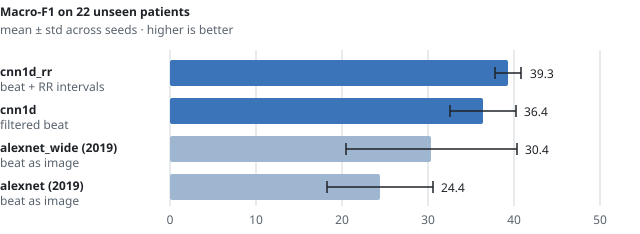

<div align="center">

# dechazal

Heartbeat classification on MIT-BIH, tested only on patients the model has never seen.

[](https://github.com/abdurmasood/dechazal/actions/workflows/ci.yml)


<picture>
  <source media="(prefers-color-scheme: dark)" srcset="docs/macro-f1-dark.svg">
  
</picture>

</div>

1. **The signal beats a picture of it.** On the same beats, a 1D CNN scores 36.4 macro-F1
   and the 2019 image CNN scores 24.4.
2. **S beats need rhythm.** Adding RR intervals raises S sensitivity from 6% to 36%.
3. **F beats don't transfer.** Nearly all of them come from one training patient and one
   test patient.

## Why it's useful

Most MIT-BIH tutorials split beats at random, so the same patient ends up in both train and
test, and accuracy looks far better than it would on a new patient. This repo uses the
standard inter-patient split from de Chazal et al. (2004) and gives you a leak-free baseline
to compare against, along with the pipeline that produced it.

| You get | Where |
|---|---|
| MIT-BIH download and preprocessing | `arrhythmia download`, `arrhythmia prepare` |
| DS1/DS2 patient split with an overlap guard | `src/arrhythmia/data/splits.py` |
| Three models with seeded training | `arrhythmia train` |
| Per-class sensitivity, PPV and F1 report | `arrhythmia report` |
| 60 tests, about 10 s, no download needed | `uv run pytest` |

## Reproduce

Requires [uv](https://docs.astral.sh/uv/). Python 3.12 is pinned in `.python-version`.

```bash
uv sync
uv run arrhythmia download                      # ~100 MB from PhysioNet into data/raw/mitdb
uv run arrhythmia prepare                       # filter, window, cache; prints class counts
uv run arrhythmia train --model cnn1d    --seeds 0 1 2 3 4
uv run arrhythmia train --model cnn1d_rr --seeds 0 1 2 3 4
uv run arrhythmia train --model alexnet  --seeds 0 1 2   # ~7 s/epoch on an RTX 4090
uv run arrhythmia report                        # prints the results table
```

Tests:

```bash
uv run pytest                                   # synthetic WFDB fixtures, no network
MITDB_DIR=data/raw/mitdb uv run pytest -m mitdb # real data: class counts must match de Chazal
```

## Per-class sensitivity

Test set: 22 DS2 patients, 49,685 beats. Mean over seeds, in %.

| Model | Input | N | S | V | F |
|---|---|---:|---:|---:|---:|
| cnn1d_rr | filtered beat + RR intervals | 71.0 | 36.3 | 69.8 | 2.5 |
| cnn1d | filtered beat | 80.3 | 5.7 | 74.9 | 0.4 |
| alexnet | beat drawn as a 224×224 image | 42.9 | 38.0 | 70.7 | 0.0 |

N normal · S supraventricular ectopic · V ventricular ectopic · F fusion.
Standard deviations and PPV are in [docs/results.md](docs/results.md#full-results).

> [!WARNING]
> Read before citing. F is one patient per side (records 208 and 213). The ± ranges show
> seed variance, not patient variance. Only the MLII lead is used. RR features look one beat
> ahead, so cnn1d_rr is an offline classifier. Full list: [Caveats](docs/results.md#caveats).

## More

- [Full results and how to read them](docs/results.md#full-results)
- [Method: split, filtering, windows, training](docs/results.md#method)
- [What changed since the 2019 version](docs/results.md#what-changed-since-2019)
- [Code layout](docs/results.md#code-layout)
- [References](docs/results.md#references)

## License

Code: [MIT](LICENSE). The MIT-BIH Arrhythmia Database is distributed by PhysioNet under its own
terms; it is downloaded at run time, not redistributed here.
